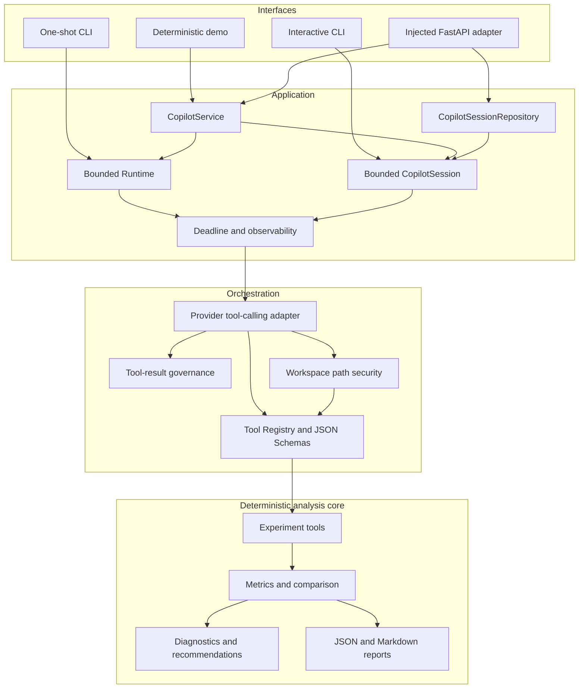

# Multimodal Experiment Copilot

**A Python Copilot for reproducible ML experiment analysis and bounded LLM tool calling.**

Comparing ML runs means more than finding the largest metric: configurations can differ, repeated runs need aggregation, and a reported score does not prove which artifact produced it. This project turns experiment configurations, metric histories and host-selected evidence into comparisons, diagnostics and recommendations with explicit limitations.

Deterministic Python tools own parsing, metric computation and statistics. An optional LLM selects approved tools and explains their returned evidence. One-shot and interactive CLIs, direct Python APIs, Service/Session abstractions and an injected FastAPI adapter provide entry points to the same analysis stack. The included FI personality-recognition experiment is one case study for a general ML workflow.

**Verified V1 integration:** [PR #59 merged](https://github.com/uewuu/multimodal-experiment-copilot/pull/59); [main CI Run #70](https://github.com/uewuu/multimodal-experiment-copilot/actions/runs/39757399767) passed Windows Full (91 files / 4891 PASS) and Linux Portable (23 files / 2030 PASS). The selections overlap; these are test outcomes, not code coverage. [Full acceptance and release status](#testing-and-status).

[Quick start](#quick-start-credential-free-deterministic-demo) | [Pairing and file demos](#more-demos) | [Architecture](#architecture) | [CI evidence](#testing-and-status) | [Documentation](#documentation)

## Quick start: credential-free deterministic demo

Python 3.11 is the supported baseline. From the repository root, install the constrained dependencies and run the first demo:

```bash
python -m pip install -c constraints-release-py311.txt -r requirements.txt
python examples/deterministic_copilot_demo.py
```

The demo:

- requires no API key and performs no network access;
- creates two small synthetic experiments in temporary storage;
- uses a deterministic fake provider compatible with the real adapter;
- traverses `CopilotService → Runtime → Adapter → Path Security → Tool Registry`;
- invokes the real `compare_experiments` tool with diagnostics enabled;
- prints stable, recursively JSON-native output.

Selected values from the [checked-in output](examples/deterministic_copilot_demo_output.json):

| Experiment | Best R2 | Best RACC |
| --- | ---: | ---: |
| baseline | 0.82 | 0.78 |
| candidate | 0.82 | 0.91 |

Ranking by R2 reports a tie and emits the real `tied_best_experiments` diagnostic; the higher RACC alone does not change that selected ranking.

## More demos

All three demos use a **fake provider** to request tools and present their actual results. They require no API key or network access during execution. Parsing, authorization, dispatch and computation use the real implementation. A real LLM provider instead receives prompts and tool results through the optional client; the offline demos do not validate its behavior. See [provider installation](#installation) and [the output guide](docs/v1_quickstart.md#inspect-output-and-exit-codes).

### Scenario E: explicit paired comparison

```bash
python examples/v1_bound_workflows_demo.py --scenario E
```

The host binds two synthetic replicate groups, A `[1, 3]` and B `[2, 7]`, and explicitly declares crossed pairs A0-B1 and A1-B0. The real `compare_paired_replicates` tool computes B-minus-A deltas. The output's `facts` contains `pair_deltas: [6.0, -1.0]`, `mean: 2.5` and `pairing_source: "host_declared"`. Pairing is never inferred from seed or input order.

This is descriptive paired evidence, not proof of experimental control, causality, statistical significance or a winner. Inspect the full `result` and `limitations` alongside the compact facts.

### Scenario G: Windows native file observation

```bash
python examples/v1_bound_workflows_demo.py --scenario G
```

Run on **Windows with local fixed NTFS storage**, including the temporary directory. The host creates a temporary direct-child `artifact.bin` containing `abc` and binds that filename before dispatch. The real M21 Reader observes the file through a validated Windows handle. Successful `facts` report `status: "observed"`, `byte_size: 3` and the computed SHA-256:

```text
ba7816bf8f01cfea414140de5dae2223b00361a396177a9cb410ff61f20015ad
```

On Linux, G returns envelope `status: "unsupported"`, `facts.status: "unsupported_platform"` and exit code 3, without a successful digest. The native reader has no accepted POSIX fallback. A digest describes the observed bytes; `no_change_detected` is best-effort change detection, not an atomic snapshot or proof of producer provenance, checkpoint binding or latest/current status.

E and successful G each report two provider requests and one tool invocation. Their JSON envelopes retain the real `result`, projected `facts`, `limitations` and `runtime`; metadata is normalized for display. See the [demo source](examples/v1_bound_workflows_demo.py) and [host fixtures](examples/v1_workflow_fixtures.py), or run [all seven workflows](#v1-offline-workflows).

## Why this project is different

- **Deterministic analysis first.** YAML/JSON parsing, metric evaluation, ranking, diagnostics, and recommendations do not depend on an LLM.
- **Grounded model orchestration.** A model can call only registered tools with explicit JSON Schemas; it does not reimplement experiment analysis in prose.
- **Bounded execution.** Provider requests, tool cycles, session history, tool-result size, and turn time are constrained.
- **Host-controlled capabilities.** The host defines the trusted experiment workspace and runtime policy. Model-generated paths cannot expand that authority.
- **Multiple interfaces, one core.** Pure Python tools, one-shot and interactive CLIs, a thin service facade, and an injected FastAPI adapter reuse the same runtime.
- **SDK-free core.** Provider integration is optional and isolated behind a client/adapter boundary.
- **Experiment statistics with declared evidence.** Single-run comparison, replicate aggregation, unpaired group comparison and explicit paired deltas use host-selected inputs. See [workflow selection](docs/v1_architecture.md).
- **Fail-closed authorization.** On the authorized default tool path, ordinary parsing errors can be isolated per experiment; a derived-path authorization violation fails the entire call. [Source and residual risks](docs/v1_security.md#default-tool-path-containment).
- **Verifiable hosted acceptance.** Windows full and Linux portable CI reconcile exact global, per-file and executed node IDs. [Main Run #70 and historical evidence](#testing-and-status) keep platform scope and release publication separate.

## Architecture

The host chooses the provider, filesystem authority, runtime policy and optional Tool bindings before execution:

1. **Host -> Service/Session:** `CopilotService` offers one-shot calls and session creation; `CopilotSession` retains bounded conversation history. The one-shot CLI can call Runtime directly.
2. **Service/Session -> Provider Adapter:** Runtime and Session coordinate provider requests, tool cycles, deadlines and observations; the adapter validates and dispatches requested tool calls.
3. **Adapter -> Tool Registry/Binding:** the default Registry exposes two tools. Explicit `BoundToolCollection` bindings add the selected advanced tools while preserving host authority.
4. **Tools -> Deterministic Core:** readers, metric analysis, comparison and statistics compute the report. The provider receives governed tool results to produce its answer.



The adapter translates provider tool calls into Registry or explicitly bound Tool dispatch. The Registry exposes copied provider schemas and immutable path-capability descriptors, while the deterministic core remains callable without any provider.

See [the architecture guide](docs/v1_architecture.md) for workflow selection and [the Python API reference](docs/v1_api_reference.md) for binding and lifecycle contracts.

## Current capabilities

- Explicitly bind evidence analysis (M16), two-experiment evidence comparison (M17), replicate aggregation (M18), unpaired group comparison (M19), host-reported artifact descriptor comparison (M20), bounded native artifact observation (M21), or explicitly paired replicate comparison (M22).
- Keep expected rosters, target mappings, pairing and artifact selection under host control. Advanced tools remain opt-in; the default Registry exposes exactly `analyze_experiment` and `compare_experiments`.
- Read `hparams.yaml` configurations and `history.json` metric histories.
- Evaluate built-in or YAML-configured metrics with maximize/minimize semantics.
- Analyze one experiment or compare and rank multiple experiments.
- Produce JSON-native summaries, Markdown reports, diagnostics, and recommendations.
- Continue multi-experiment comparison after ordinary experiment parsing failures; on the host-authorized default tool path, authorization violations fail the entire call closed.
- Expose `analyze_experiment` and `compare_experiments` through a vendor-neutral Tool Registry and JSON Schemas.
- Execute bounded single-cycle and multi-turn tool-calling flows.
- Enforce workspace path capabilities for experiment directories and metric configuration files.
- Limit serialized tool results to 256 KiB each and 512 KiB per tool cycle; results are rejected rather than truncated or summarized.
- Apply provider timeouts and Copilot turn-deadline checkpoints.
- Report payload-free failure observations while preserving the original exception.
- Maintain bounded in-memory sessions with JSON-safe transcript export.
- Manage process-local sessions through `CopilotSessionRepository`.
- Offer a borrowed-client `CopilotService` facade.
- Embed the system through an injected, serialized FastAPI adapter.

## Installation

The V1 delivery target is **source-based Python 3.11 use**. Run from a clone of this repository; editable installation, wheels and PyPI delivery are not currently supported. M9–M23 V1 is merged into `main` through [PR #59](https://github.com/uewuu/multimodal-experiment-copilot/pull/59), and post-merge main CI Run #70 passed Windows full and Linux portable acceptance. The historical `v0.1.0` Release is separate from this integration; no new `v0.2.0` tag or Release has been published.

Install the project, analysis, HTTP, and test dependencies:

```bash
python -m pip install -c constraints-release-py311.txt -r requirements.txt
```

The optional OpenAI-compatible provider client is deliberately separate:

```bash
python -m pip install -c constraints-release-py311.txt -r requirements-openai.txt
```

Set `OPENAI_API_KEY` only when using a real provider. The deterministic core and demo do not read it.

PowerShell:

```powershell
$env:OPENAI_API_KEY = "<your-api-key>"
```

Bash:

```bash
export OPENAI_API_KEY="<your-api-key>"
```

## Copilot interfaces

### One-shot CLI

Ask one question about an experiment directory:

```bash
python -m copilot \
  --model "<model>" \
  --question "Summarize the strongest validation result and any risks." \
  --experiment-dir examples/demo_experiment
```

Supported optional flags are `--experiment-dir`, `--base-url`, and `--timeout`. The CLI constructs and closes its provider client, runs one bounded Copilot turn, and prints the answer.

### Interactive CLI

Start a bounded in-memory conversation:

```bash
python -m copilot.interactive \
  --model "<model>" \
  --experiment-dir examples/demo_experiment \
  --max-turns 8
```

Supported commands are:

- `/help` — show available commands;
- `/reset` — clear retained session history;
- `/exit` or `/quit` — end the session.

The interactive entry point also supports `--base-url` and `--timeout`. Session history is process-local and bounded by `--max-turns`.

### Python Tool Layer

The deterministic tools and Registry can be used directly:

```python
from tool_layer import (
    analyze_experiment,
    compare_experiments,
    invoke_tool,
    list_tools,
)

single = analyze_experiment(
    "examples/demo_experiment",
    include_diagnostics=True,
)

comparison = invoke_tool(
    "compare_experiments",
    {
        "experiment_root": "examples",
        "include_diagnostics": True,
    },
)

schemas = list_tools()
```

`list_tools()` returns isolated, JSON-safe provider schemas. `invoke_tool()` returns the original tool result and preserves underlying exceptions.

## Deterministic report workflows

The original report commands remain useful when no provider is needed.

Single experiment:

```bash
python generate_report.py \
  --experiment-dir examples/demo_experiment \
  --output-dir outputs/demo_experiment \
  --include-diagnostics
```

Multi-experiment comparison:

```bash
python compare_experiments.py \
  --experiment-root examples \
  --output-path outputs/comparison.json \
  --markdown-output-path outputs/comparison.md \
  --sort-by best_r2 \
  --include-diagnostics
```

Each direct child of `--experiment-root` is treated as an experiment only when it contains both `hparams.yaml` and `history.json`. Discovery is not recursive.

### Configurable metrics

Metric definitions live in an independent YAML file. Each `path` must match the actual nested path in every relevant `history.json`.

For the bundled FI fixture, save the following as `metrics.fi-demo.yaml` in the repository root:

```yaml
metrics:
  - name: r2
    path: [valid, app, r2]
    direction: maximize
    display_name: R2
    precision: 4

  - name: racc
    path: [valid, app, racc]
    direction: maximize
    display_name: RACC
    precision: 4
```

Then run:

```bash
python compare_experiments.py \
  --experiment-root examples \
  --metrics-config metrics.fi-demo.yaml \
  --sort-by racc \
  --output-path outputs/dynamic-comparison.json \
  --markdown-output-path outputs/dynamic-comparison.md \
  --include-diagnostics
```

The reusable schema example at [`configs/metrics.example.yaml`](configs/metrics.example.yaml) demonstrates generic `validation.metrics.*` paths. It is not intended for the bundled FI history, whose metric paths are `valid.app.*`.

`direction` selects the best value within each experiment. Cross-experiment order remains explicit: omit `--ascending` for descending order or add it for ascending order.

## Injected FastAPI adapter

`copilot.http_api.create_app` is an embeddable transport adapter, not a turnkey public server. Host code owns the provider client, constructs the service and repository, and supplies trusted policy:

```python
from copilot import CopilotService, CopilotSessionRepository
from copilot.http_api import create_app
from llm_clients import create_openai_client

client = create_openai_client(timeout=30.0)
service = CopilotService(client, model="<model>")
sessions = CopilotSessionRepository(service, max_sessions=100)

app = create_app(
    service,
    sessions,
    experiment_context={"experiment_root": "/srv/experiments"},
    max_turns=8,
    turn_timeout_seconds=30.0,
)
```

The host is responsible for closing the borrowed provider client and for choosing an ASGI deployment strategy. The adapter exposes exactly five routes:

| Method | Route | Purpose |
| --- | --- | --- |
| `POST` | `/v1/copilot/turns` | Run one observed Copilot turn |
| `POST` | `/v1/sessions` | Create a bounded session |
| `POST` | `/v1/sessions/{session_id}/turns` | Run a session turn |
| `DELETE` | `/v1/sessions/{session_id}` | Delete a session |
| `GET` | `/health` | Return process health |

Business operations share one application-scoped serialization lock; `/health` bypasses that lock. Errors are mapped to intentionally limited HTTP messages, and structured results are serialized explicitly.

Current HTTP deployment contract:

- single process and single worker;
- process-local, in-memory sessions;
- no built-in authentication, CORS policy, persistence, or Uvicorn launcher;
- no provider-client construction or ownership inside the adapter.

Deploying it beyond a trusted environment requires a host application to supply those missing controls.

## Security and execution boundaries

The **host**, not the model or HTTP caller, defines the trusted experiment workspace and server policy.

Workspace authorization is separate from Python object-protocol safety. M16/M17 use the [Legacy Trusted-Host Python API (v1)](docs/v1_security.md#m16-m17-legacy-trusted-host-python-v1): the host reviews construction/copy/traversal protocols and stable input lifetimes; arbitrary custom objects have no zero-callback rejection or universal copy-isolation guarantee. M18/M19 retain their separate strict snapshot contracts. External custom hosts, plugins and SDK extensions are **NOT AUDITED / HOST RESPONSIBILITY**.

- Tool path parameters are resolved against host-provided `experiment_context` capabilities.
- Traversal, absolute paths outside the workspace, cross-drive paths, UNC/special Windows paths, and symlink/junction escapes are rejected.
- `metrics_config` is governed by the same workspace boundary as experiment paths.
- On the host-authorized default Adapter path, derived experiment directories and required files are checked during scanning and again before reading; optional metric configuration files are checked before reading. Internal symlinks/junctions may resolve elsewhere within the host-authorized root, including outside a selected scan subdirectory, provided their targets have the required types and pass link checks. External targets and unsafe links fail the entire call closed.
- These checks assume a trusted, host-managed filesystem. Validation and path-based opening are not atomic; concurrent namespace changes retain TOCTOU risk. They do not provide a filesystem sandbox or M21's Windows opened-handle validation. See [default tool path boundaries](docs/v1_security.md#default-tool-path-containment).
- HTTP request bodies accept only the approved question payload. Callers cannot redefine the workspace, tools, model/provider configuration, request options, turn timeout, maximum session history, or repository capacity.
- Provider tool calls are structurally validated before execution.
- Tool results exceeding 256 KiB individually or 512 KiB per cycle are rejected before another provider request.
- Provider timeouts and turn-deadline checkpoints bound cooperative work; this is not pre-emptive thread or process cancellation.
- Failure observations contain stage, counts, and elapsed time—not prompts, credentials, tool arguments, or tool results—and never replace the original exception.
- The Registry and core runtime do not import a provider SDK, read credentials, or perform network calls at import time.

## Experiment inputs and outputs

An experiment directory contains:

```text
experiment-name/
├── hparams.yaml
└── history.json
```

Metric history values use `[epoch, value]` records at paths selected by a built-in or configured metric specification.

Available structured outputs include:

- single-experiment configuration and metric summaries;
- ranked comparison records and isolated failures;
- deterministic facts, diagnostics, and recommendations;
- Copilot turns with tool invocation records;
- provider/tool counts and elapsed-time observations;
- JSON-safe bounded-session transcript exports;
- JSON and Markdown report files for direct report workflows.

Generated files under `outputs/` are ignored by Git.

## FI case study

[`examples/demo_experiment`](examples/demo_experiment) contains maintainer-authorized, sanitized experiment configuration metadata and aggregate metric histories generated from the maintainer's own FI experiments. It demonstrates realistic R2, RACC, and individual trait metrics.

FI is an example workload, not a product specialization. The fixture does not include the underlying FI dataset, source media, pretrained model weights, or checkpoints, and it does not grant rights to those external materials. The credential-free deterministic demo uses separate generic synthetic experiments.

## Testing and status

Current post-merge acceptance: [main CI Run #70](https://github.com/uewuu/multimodal-experiment-copilot/actions/runs/39757399767), commit `e437795e041247bba9ae9c83b7af37a77ae0f706`:

```text
Windows Full: 91 files / G=F=E=4891 / 4891 PASS
Linux Portable: 23 files / G=F=E=2030 / 2030 PASS
Both lanes: FAIL / ERROR / SKIP / XFAIL / XPASS = 0
```

G/F/E denote global collection, per-file collection and executed node IDs; exact reconciliation passed. The platform selections overlap and differ, so their counts must not be added as a unique test total. These are test outcomes, not code-coverage percentages. Linux acceptance is limited to the portable subset; M21 native acceptance remains Windows/local NTFS only.

Historical M23 Slice 3 evidence (before the final integration and audit fixes):

```text
Windows full: 86 files / 4647 collected / 4647 executed / 4647 PASS
Exact global/per-file/executed node-ID reconciliation: COMPLETE
M23 contracts: 71 / 71 PASS; remaining RED: 0
M21 native Windows/local NTFS: 8 / 8 native tests PASS
Fresh Python 3.11 venv: install/import/pip check and existing + A-G demos PASS
Linux portable: 22 files / 1964 collected / 1964 executed / 1964 PASS
Temporary Ubuntu CI: run 38114641921 SUCCESS; remote Windows CI was pending at that stage
```

The historical full Windows run used one execution subprocess per test file. FAIL, ERROR, SKIP, XFAIL and XPASS were all zero. That Windows evidence applies to Windows/local NTFS with its recorded dependencies; it does not establish Linux support or release publication.

From the source root with Python 3.11 and the tested dependency constraints:

```bash
python -m pip install -c constraints-release-py311.txt -r requirements.txt
python -B scripts/run_release_checks.py --lane windows-full > windows-full.json
# Linux portable subset only:
python -B scripts/run_release_checks.py --lane portable --test-list scripts/release-portable-files.json > linux-portable.json
```

GitHub Actions is configured for Windows full and an explicit 23-file Linux portable subset, including fail-closed unsupported-platform checks. Run #70 is the formal post-merge main acceptance; the earlier [temporary validation run 38114641921](https://github.com/uewuu/multimodal-experiment-copilot/actions/runs/38114641921) covered the historical 22-file subset. See [testing and release evidence](docs/v1_testing_release.md) for exact scope, dependency history and report handling. The known Starlette/httpx deprecation warning remains visible.

## V1 offline workflows

Run each scenario independently, without credentials or network access:

```bash
python examples/v1_bound_workflows_demo.py --scenario A
python examples/v1_bound_workflows_demo.py --scenario B
python examples/v1_bound_workflows_demo.py --scenario C
python examples/v1_bound_workflows_demo.py --scenario D
python examples/v1_bound_workflows_demo.py --scenario E
python examples/v1_bound_workflows_demo.py --scenario F
python examples/v1_bound_workflows_demo.py --scenario G
```

Only the provider is fake. Each scenario traverses the real Session, Adapter, explicitly bound Tool and Core. A/B/G prepare temporary files; C–F use in-memory host snapshots. Output is one strict JSON object containing the actual tool report, grounded facts, limitations and runtime counts. E demonstrates explicit crossed pairing with deltas `[6, -1]`, mean `2.5`; D reports an unpaired group mean difference.

A–F passed the separate Ubuntu validation run. G requires Windows/local NTFS and uses the real M21 Reader. Unsupported platforms return `unsupported` with exit code 3, without a fabricated digest. M21 observes one file of at most 1 MiB, with best-effort change detection; it does not verify producer provenance, checkpoint binding, latest/current status or an atomic snapshot. Older YAML/history readers do not share this uniform byte bound.

## Documentation

- [Quickstart and output guide](docs/v1_quickstart.md)
- [Python API reference](docs/v1_api_reference.md)
- [Architecture and workflow selection](docs/v1_architecture.md)
- [Security, trust and platform limits](docs/v1_security.md)
- [Testing and release status](docs/v1_testing_release.md)

## Current limitations

- Experiment discovery scans direct child directories only.
- Metric paths are explicit string-key sequences; there is no JSONPath or automatic metric discovery.
- Diagnostics and recommendations are deterministic rules, not causal proof or a substitute for domain review.
- Tool calling is bounded and synchronous; there is no background job system or pre-emptive cancellation.
- Sessions and their repository are in-memory and process-local.
- The FastAPI adapter intentionally omits authentication, CORS, persistence, and a server launcher.
- Real-provider behavior depends on the injected provider-compatible client and model.
- The repository is not yet packaged as an installable distribution.

## License

The project's first-party source code and documentation are licensed under the [Apache License 2.0](LICENSE). See `LICENSE` for the full terms.

Third-party dependencies, datasets, pretrained models, and external assets remain subject to their own licenses and terms.

## Roadmap

Near-term work should deepen the existing product boundaries rather than replace them with a new framework:

- improve user-facing examples and operational documentation;
- strengthen evaluation of grounded Copilot answers and tool-selection behavior;
- define authentication and persistence requirements before broader HTTP deployment;
- add concurrency hardening before any multi-worker session architecture;
- improve packaging and release ergonomics.

RAG, LangGraph, MCP, multi-agent orchestration, a frontend, and distributed persistence are possible future explorations, not current commitments or immediate prerequisites.
