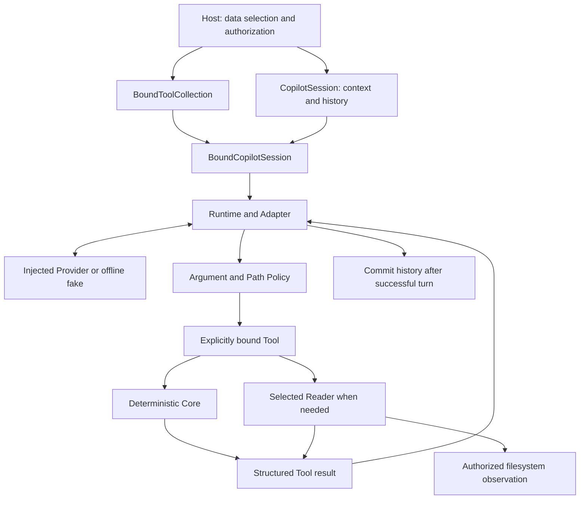

# V1 architecture

The host selects data and authority. Deterministic code evaluates evidence; an optional provider chooses advertised tools and explains their structured results. The offline example substitutes provider messages only.

This shows a call boundary, not an automatic sequence of milestones. Each A–G workflow is selected independently. M20 is never automatically combined with M21.

## Workflow selection

| Layer | Responsibility | Evidence boundary |
| --- | --- | --- |
| M11 identity/comparability | Explicit experiment/execution keys and policy comparison | Agreement of declarations, not their truth |
| M12 Memory/Repository | Historical storage, lifecycle and queries | An active record is not a current artifact |
| M13 evaluation | Structured expected facts, scenarios and baseline comparisons | Scored structured contracts, not universal prose verification |
| M14 Memory tools | Explicit scope/provider binding | Host controls discovery scope |
| M15 controlled workflow | Approval, lifecycle and idempotency for simulation | No real training or deployment action |
| M16 evidence | Read selected configuration, history and CSV evidence | File-reported metrics retain unknown checkpoint binding |
| M17 pairwise evidence | Two experiments, explicit metric targets, B minus A | Alignment and M11 comparability determine allowed observation |
| M18 aggregation | Full expected roster, eligibility, coverage, descriptive statistics | Snapshots and membership are host-declared |
| M19 group comparison | Real M18 twice plus M11 cross-group comparison | Unpaired difference of group means |
| M20 descriptors | Compare declared and reported fields in memory | `host_reported`; no file observation |
| M21 observation | Authorized handle, bounded bytes, incremental digest | Observed stream; no checkpoint/currentness proof |
| M22 explicit pairs | One-to-one declarations, full-group gates, pair deltas | Host-declared paired descriptive statistics |

M17 compares two evidence bundles and does not define replicate pairing. M19 uses each group's aggregation and does not infer pairs. M22 retains full execution identities, declared-pair denominators, missing/excluded/unpaired partitions and per-pair values. It still sends both complete groups to M18: dropping an unpaired conflicting member to obtain a favorable statistic would violate the contract. Summary precedence remains blocked, insufficient, limited, eligible.

## Entry points and lifetime

`CopilotService` borrows a provider client for one-shot calls and Session creation. `CopilotSession` owns bounded in-memory conversation history. `BoundCopilotService` and `BoundCopilotSession` temporarily activate a stable collection and restore the previous binding on both success and failure. No second Session framework is introduced by the demo.

The default Registry contains exactly `analyze_experiment` and `compare_experiments`. `BoundToolCollection` copies schemas, rejects duplicate names and adds only host-selected advanced tools. Snapshot selection is not delegated to the provider. Live file tools still pass through Path Policy and their own binding checks.

On a successful demo turn the Adapter dispatches one tool, sends its actual JSON result to the fake provider, and receives a facts projection. Session history commits only when the turn succeeds. A failure restores binding and leaves history uncommitted; this cannot undo arbitrary host callback side effects.

## I/O separation

M18/M19/M20/M22 consume supplied structures; they do not discover files or retrieve Memory. M16/M17 use selected readers. M21 separates pure binding/projection (`artifact_observation.py`), authorized Windows handles (`artifact_observation_io.py`) and bounded streaming (`artifact_observation_reader.py`). Its Tool invokes the Reader afresh without caching. The examples perform fixture preparation outside Tool dispatch.

The source delivery remains Python 3.11. The existing CLIs and injected HTTP adapter share the runtime, but the new advanced workflows are demonstrated through explicit Python binding. Existing CLI/HTTP exposure is not silently expanded.
